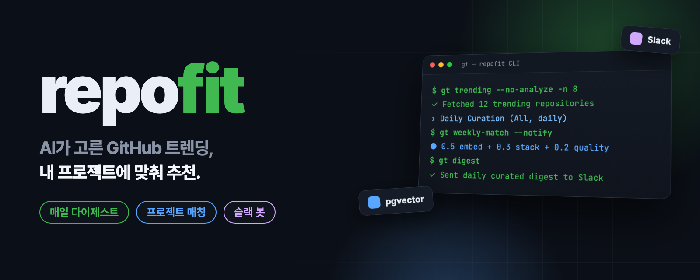
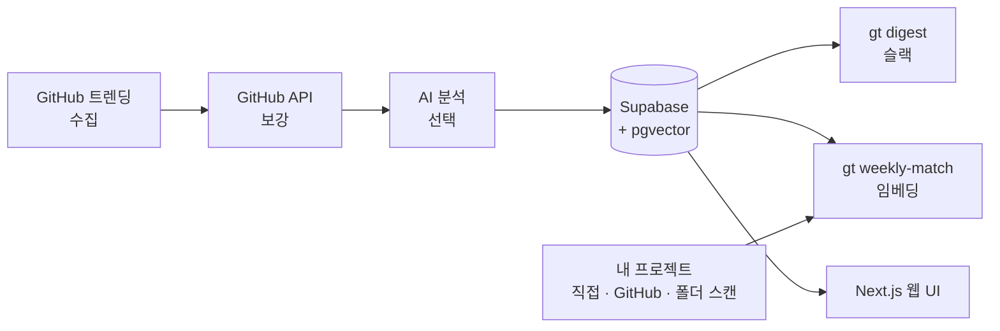

<p align="center">
  
</p>

<p align="center">
  <a href="README.md"><b>English</b></a> · <b>한국어</b>
</p>

<h2 align="center">GitHub 트렌딩을 매일 뒤지지 마세요.<br>지금 만드는 프로젝트에 맞는 레포만 받아 보세요.</h2>

<p align="center">
  repofit은 매일 GitHub 트렌딩을 모아 점수를 매기고, 짧게 고른 다이제스트를 슬랙으로 보냅니다.<br>
  매주 한 번은 저장된 레포를 내 프로젝트와 임베딩·기술 스택 기준으로 매칭합니다.
</p>

<p align="center">
  <a href="LICENSE"></a>
  <a href="https://github.com/kks0488/repofit/stargazers"></a>
  
  
</p>

<table>
<tr>
<td width="50%" valign="top">

### 그냥 목록이 아닌 큐레이션
트렌딩 레포를 GitHub API로 보강한 뒤 오늘 받은 별 수, 규모 대비 성장, 품질 점수로 순위를 매깁니다. 상위 몇 개만 남깁니다.

</td>
<td width="50%" valign="top">

### "왜 중요한지" 한 줄 요약
OpenAI 호환 모델이 레포마다 요약·활용 예·위험 요소를 씁니다. `--no-analyze`로 AI 없이도 쓸 수 있습니다.

</td>
</tr>
<tr>
<td width="50%" valign="top">

### 내 프로젝트와 매칭
프로젝트를 직접 등록하거나, GitHub 계정에서 가져오거나, 로컬 폴더를 스캔합니다. `gt weekly-match`가 스택·키워드로 거른 뒤 pgvector 임베딩으로 다시 정렬합니다.

</td>
<td width="50%" valign="top">

### 슬랙 다이제스트와 봇
`gt digest`가 고른 레포를 "Rising fast" 표시와 함께 보냅니다. 선택 사항인 Socket Mode 봇은 저장된 레포 데이터로 질문에 답합니다(langchain RAG).

</td>
</tr>
</table>

## 설치

Python 3.11 이상이 필요합니다.

```bash
git clone https://github.com/kks0488/repofit.git && cd repofit
python -m venv .venv && source .venv/bin/activate
pip install -e .
```

## 빠른 시작

데이터베이스나 AI 키 없이 오늘의 트렌딩 큐레이션을 볼 수 있습니다(`GITHUB_TOKEN`은 선택이며 API 한도만 늘려 줍니다).

```bash
export SUPABASE_URL=https://example.supabase.co SUPABASE_ANON_KEY=x SUPABASE_SERVICE_KEY=x  # 자리 표시용, 이 명령에서는 쓰지 않음
gt trending --no-analyze -n 10
```

전체 흐름에는 Supabase(Postgres + pgvector)와 OpenAI 호환 API가 필요합니다.

```bash
cp .env.example .env        # Supabase, OpenAI, (선택) Slack 값 입력
gt init                     # env 파일 생성, Supabase 스키마(schema.sql) 확인
gt quickstart               # 첫 큐레이션 스냅샷 저장

gt project-add --name "MyApp" --stack "python,fastapi" --tags "api,web"
gt github-sync              # 또는 내 GitHub 레포를 프로젝트로 가져오기

gt digest                   # 오늘의 다이제스트를 슬랙으로 전송
gt weekly-match             # 저장된 레포를 내 프로젝트와 매칭
```

## 데모

`gt trending --no-analyze` 실제 실행 결과(2026년 10월)와 테스트 실행입니다.

<p align="center"></p>

## 동작 방식



- **일일 점수:** `0.5 × 추세(오늘 별 / 250) + 0.3 × 성장(오늘 별 ÷ 전체 별 × 8) + 0.2 × 품질`, 각 항목 최대 1.
- **주간 매칭:** 1단계에서 기술 스택·키워드·품질로 거르고, 2단계에서 임베딩 유사도(`text-embedding-3-small`)로 다시 정렬합니다.
  `score = 0.5 × embedding_similarity + 0.3 × stack_overlap + 0.2 × quality_score`

## 자주 묻는 질문

**OpenAI가 꼭 필요한가요?**
둘러보기만 할 때는 아닙니다. `gt trending --no-analyze`는 GitHub만 씁니다. AI 요약과 프로젝트 매칭에는 OpenAI 호환 API가, 매칭에는 `OPENAI_EMBEDDING_API_KEY`도 필요합니다.

**왜 Supabase인가요?**
스냅샷·이력·프로젝트·임베딩을 저장합니다. Supabase SQL 편집기에서 `schema.sql`을 한 번 실행하면 되고, 모든 테이블은 `gt_` 접두어를 씁니다.

**정해진 시간에 자동으로 돌릴 수 있나요?**
네. `gt schedule`(계속 실행), `scripts/`의 systemd 타이머, cron, GitHub Actions 중 하나를 쓰면 됩니다. 아래 기술 세부 사항을 보세요.

## 로드맵 (계획, 아직 구현 안 됨)

- `pipx install`용 CLI 패키지.
- 슬랙 다이제스트의 언어·주제 필터.
- 웹 UI 공개 데모.

---

<details>
<summary><b>기술 세부 사항</b></summary>

### CLI 명령

| 명령 | 설명 |
|------|------|
| `gt init` | env 파일 생성, Supabase 스키마 확인 |
| `gt setup` | 설정 확인과 안내 |
| `gt quickstart` | 일일 큐레이션 데이터 빠르게 저장 |
| `gt` / `gt trending` | 오늘의 트렌딩 큐레이션 보기(`--lang`, `--since`, `-n`, `--no-enrich`, `--no-analyze`, `--save`) |
| `gt digest` | 슬랙 다이제스트 즉시 전송 |
| `gt inspect owner/repo` | 레포 상세 분석 |
| `gt history owner/repo` | 레포의 트렌딩 이력 |
| `gt snapshots` | 저장된 스냅샷 목록 |
| `gt projects` | 내 프로젝트 목록 |
| `gt project-add` | 프로젝트 등록 |
| `gt github-sync` | 내 GitHub 레포를 프로젝트로 동기화(`--starred`는 별표 레포도 표시) |
| `gt scan-projects ~/projects` | 로컬 폴더에서 프로젝트 찾기 |
| `gt weekly-match` | 전체 프로젝트 주간 매칭(`--project <id>`로 하나만) |
| `gt match` | `gt weekly-match`의 별칭 |
| `gt recommendations` | AI 추천 보기 |
| `gt discover` | 내 프로젝트에 맞는 레포를 GitHub에서 검색 |
| `gt sync` | 일일 동기화(수집 → 분석 → 저장), `--notify`면 다이제스트도 전송 |
| `gt schedule` | 정해진 시각(기본 19:00)에 일일 동기화 |
| `gt bot` | 슬랙 자동 응답 봇 시작(Socket Mode) |

### 환경 변수

```bash
# 백엔드 (.env)
SUPABASE_URL=https://your-project.supabase.co
SUPABASE_ANON_KEY=your-anon-key
SUPABASE_SERVICE_KEY=your-service-key
OPENAI_API_KEY=your-openai-key
OPENAI_BASE_URL=https://api.openai.com/v1   # OpenAI 호환 엔드포인트
OPENAI_MODEL=gpt-5.2
OPENAI_EMBEDDING_API_KEY=your-openai-embedding-key
GITHUB_TOKEN=your-github-token              # github-sync, API 한도 증가

# 슬랙 (선택)
SLACK_BOT_TOKEN=xoxb-xxx
SLACK_APP_TOKEN=xapp-xxx                    # Socket Mode, gt bot용
SLACK_CHANNEL_ID=C0123456789
SLACK_NOTIFY_THRESHOLD=0.7

# 프런트엔드 (web/.env.local)
NEXT_PUBLIC_SUPABASE_URL=your-supabase-url
NEXT_PUBLIC_SUPABASE_ANON_KEY=your-anon-key
```

`OPENAI_BASE_URL`을 비워 두면 코드 기본값은 로컬 OpenAI 호환 프록시(`http://localhost:8317/v1`)입니다. OpenAI API를 쓸 때는 직접 지정하세요.

### 슬랙 설정

1. [api.slack.com/apps](https://api.slack.com/apps)에서 앱을 만들고 봇 토큰 권한 `chat:write`, `channels:read`, `channels:history`를 추가합니다. 설치 후 `xoxb-` 토큰을 복사하고 채널에서 `/invite @YourBot`.
2. 봇을 쓰려면 Socket Mode를 켜고 `connections:write` 권한의 앱 토큰(`xapp-`)을 만든 뒤, 이벤트에서 `message.channels`, `app_mention`을 구독합니다.
3. 토큰과 채널 ID를 `.env`에 넣습니다.

채널이나 스레드에 입력하는 봇 명령:

| 메시지 | 동작 |
|--------|------|
| `스캔` / `scan` | 프로젝트 폴더 스캔 → 등록 → 매칭 |
| `추천` / `recommend` | 추천 결과 전송 |
| `트렌딩` / `trending` | 트렌딩 TOP 10 전송 |
| `매칭` / `match` | 매칭 실행 후 결과 전송 |

그 밖의 질문에는 저장된 레포 데이터를 검색해 답합니다(langchain + pgvector).

다이제스트 형태 예시(가상의 레포):

```
📌 RepoFit Daily Trending Curation
🌐 All languages • 10 picks from 25 trending repos
────────────────────────────
*AI/ML*
  owner/repo-a ⭐ 12,421 · +684 today ⚡ Rising fast
  Why: High-velocity open-source agent framework with practical tooling.
────────────────────────────
Top 10 only: highest momentum + quality signals
```

### 일일 자동화

systemd 사용자 타이머:

```bash
mkdir -p ~/.config/systemd/user
cp scripts/repofit-daily.{service,timer} ~/.config/systemd/user/
systemctl --user daemon-reload
systemctl --user enable --now repofit-daily.timer
```

cron:

```bash
0 19 * * * cd /path/to/repofit && ./scripts/daily-digest.sh   # 매일 다이제스트
0 9 * * 1 cd /path/to/repofit && ./scripts/weekly-match.sh    # 월요일 주간 매칭
```

GitHub Actions: `.github/workflows/daily-sync.yml`이 매일 `gt sync --notify`를 실행합니다. 저장소 시크릿 `SUPABASE_URL`, `SUPABASE_ANON_KEY`, `SUPABASE_SERVICE_KEY`, `OPENAI_API_KEY`, `SLACK_BOT_TOKEN`, `SLACK_CHANNEL_ID`(선택: `OPENAI_BASE_URL`, `OPENAI_MODEL`)를 추가하세요.

### 웹 UI

```bash
cd web
npm install
npm run dev   # http://localhost:3003
```

최신 트렌딩, 내 프로젝트(추가·목록), 추천 화면이 있으며 모두 Supabase에서 읽습니다.

### 기술 스택

| 구성 | 기술 |
|------|------|
| CLI | Python, Typer, Rich |
| AI | OpenAI 호환 API(분석 + 임베딩), langchain |
| 데이터베이스 | Supabase(PostgreSQL + pgvector) |
| 프런트엔드 | Next.js 16, React 19, Tailwind CSS 4, TanStack Query |
| HTTP / 수집 | httpx(async), selectolax |
| 알림 | Slack Block Kit, slack-bolt(Socket Mode) |

### 테스트

```bash
pip install -e ".[dev]"
pytest -q
```

### 문제 해결

- **스키마 없음:** Supabase SQL 편집기에서 `schema.sql` 실행.
- **추천 없음:** `OPENAI_EMBEDDING_API_KEY` 설정 후 `gt weekly-match`.
- **슬랙 안 됨:** `SLACK_BOT_TOKEN`, `SLACK_CHANNEL_ID` 확인.
- **프로젝트 매칭 없음:** 먼저 `gt project-add`로 프로젝트 등록.
- **GitHub 동기화 실패:** `GITHUB_TOKEN` 권한(repo) 확인.

</details>

## 라이선스

[MIT](LICENSE) © 2026 Kyoungsoo Kim
