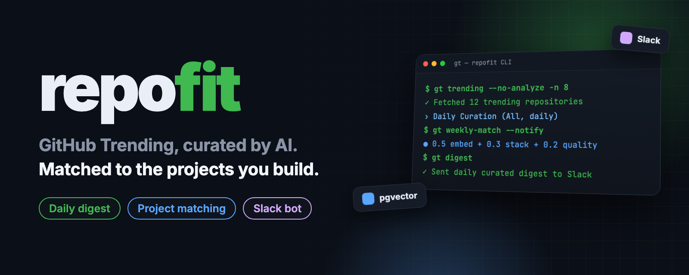
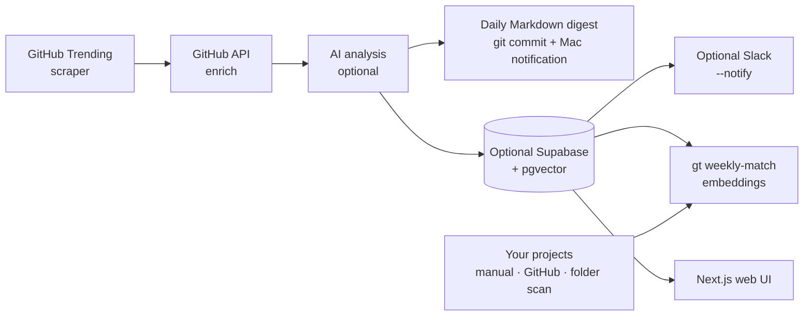

<p align="center">
  
</p>

<p align="center">
  <b>English</b> · <a href="README.ko.md"><b>한국어</b></a>
</p>

<h2 align="center">Stop scrolling GitHub Trending.<br>Get the repos that fit what you're building.</h2>

<p align="center">
  repofit collects GitHub Trending every day, commits a short Markdown digest, and shows a macOS notification.<br>
  Once a week it matches stored repos against your own projects using embeddings and stack overlap.
</p>

<p align="center">
  <a href="LICENSE"></a>
  <a href="https://github.com/kks0488/repofit/stargazers"></a>
  
  
</p>

<table>
<tr>
<td width="50%" valign="top">

### Daily curation, not a raw list
Trending repos are enriched through the GitHub API and ranked by momentum (stars today), growth relative to size, and a quality score. Only the top picks are kept.

</td>
<td width="50%" valign="top">

### "Why it matters" in one line
An OpenAI-compatible model writes a short summary, use cases and risks for each repo. Run with `--no-analyze` to skip AI entirely.

</td>
</tr>
<tr>
<td width="50%" valign="top">

### Matched to your projects
Register projects by hand, sync them from your GitHub account, or scan a local folder. `gt weekly-match` filters by stack and keywords, then reranks with pgvector embeddings.

</td>
<td width="50%" valign="top">

### Daily digest and Mac notification
`gt digest` writes `digests/YYYY-MM-DD.md` with top picks, why they matter, and project matches. Slack delivery and the Socket Mode bot remain optional; sending is off by default.

</td>
</tr>
</table>

## Install

Requires Python 3.11+.

```bash
git clone https://github.com/kks0488/repofit.git && cd repofit
python -m venv .venv && source .venv/bin/activate
pip install -e .
```

## Quick start

**[Read the daily Markdown digests](https://github.com/kks0488/repofit/tree/main/digests)** — no local server is needed. JSON snapshots also remain available in the [daily workflow](https://github.com/kks0488/repofit/actions/workflows/daily-sync.yml).

See today's curated Trending without any database or AI key (a `GITHUB_TOKEN` is optional and only raises the API rate limit):

```bash
gt trending --no-analyze -n 10
```

Save a daily snapshot without a database or paid service:

```bash
gt sync --no-analyze                       # writes repofit-snapshot.json
gt sync --no-analyze --output /tmp/picks.json
gt digest --no-analyze                    # writes digests/YYYY-MM-DD.md with project matches
```

`gt sync` automatically uses JSON when database credentials are absent. `--output` always
selects JSON, even if Supabase is configured. Without an AI key, analysis automatically
uses the existing activity/popularity scoring; `--no-analyze` explicitly skips the model.
The JSON contains all collected repositories, summaries/metadata, and the ranked top picks.

`gt fit` assesses the latest digest (or snapshot) against `~/projects/<category>/<project>` docs.
Profiles go only to the configured LLM; private results stay outside Git at `~/.local/share/repofit/fit/YYYY-MM-DD.md`.
Use `--input`, `--projects-dir`, and `--out-dir` to override paths; skill picks include `npx skilladopt add owner/repo`.
Configure `--llm-base-url/--llm-model/--llm-key-cmd` or `REPOFIT_FIT_BASE_URL`, `REPOFIT_FIT_MODEL`, `REPOFIT_FIT_KEY_CMD`; defaults use Hive and macOS Keychain.

For AI summaries, configure any OpenAI-compatible endpoint. Nebius Token Factory example:

```bash
export OPENAI_API_KEY="$(security find-generic-password -s nebius-token-factory -a kks0488 -w)"
export OPENAI_BASE_URL=https://api.tokenfactory.nebius.com/v1
export OPENAI_MODEL=nvidia/Nemotron-3_5-Lightning
gt sync --output repofit-snapshot.json
```

An existing API key may consume provider credits; the no-key path requires no AI service.
Never commit keys or `.env` files. JSON snapshots contain repository data only.
Supabase (Postgres + pgvector) remains optional for the web UI, project registry and weekly embedding matches:

```bash
cp .env.example .env        # fill in Supabase, OpenAI and (optionally) Slack values
gt init                     # creates env files and checks the Supabase schema (schema.sql)
gt quickstart               # seeds the first curated snapshot

gt project-add --name "MyApp" --stack "python,fastapi" --tags "api,web"
gt github-sync              # or import your GitHub repos as projects

gt digest                   # write digests/YYYY-MM-DD.md (add --notify for Slack)
gt weekly-match             # match stored repos to your projects
```

## Search by need

```bash
gt need-search "automate gemini.google.com from scripts without API"
gt need-search "bulk image generation via Google Flow web"
```

No AI key or database is needed. Authentication uses `GITHUB_TOKEN`, `GH_TOKEN`, or your
existing `gh auth login` session; unauthenticated requests also work within GitHub's lower
rate limits. The command expands the need into bounded GitHub repository/README searches,
requires **at least 300 stars**, a push within **six calendar months**, and excludes forks
and archived repos. It deduplicates candidates and ranks documented task fit before star
count, with a small popularity tie-breaker. It fetches at most 20 READMEs per search.
Up to five matches include stars, last push, license and a one-line fit excerpt; `UNKNOWN`
means GitHub did not report a license. Results show documented fit, not a tested integration;
candidate tools may require a signed-in browser, cookies or an existing provider plan.

Real command output captured on **2026-10-16** (stars and results change over time):

```text
$ gt need-search "automate gemini.google.com from scripts without API"
Need: automate gemini.google.com from scripts without API
Filters: stars >= 300; pushed in the last 6 months; not archived or forks.
1. zexadev/gemini-web2api-go | 615 stars | pushed 2026-10-14 | MIT
   https://github.com/zexadev/gemini-web2api-go
   Fit: Gemini web → OpenAI-compatible API, self-hosted, no API key. Reverse-proxies gemini.google.com into /v1/chat/completions: single Go binary, Chrome TLS fingerprint, cookie pool with auto-renewal, proxy pool, adm…
2. ntthanh2603/gemini-web-to-api | 588 stars | pushed 2026-10-16 | MIT
   https://github.com/ntthanh2603/gemini-web-to-api
   Fit: ✨Reverse-engineered API for Gemini web app. It can be used as a genuine API key from OpenAI, Gemini, and Claude.
3. Sophomoresty/gemini-web2api | 3,458 stars | pushed 2026-08-14 | MIT
   https://github.com/Sophomoresty/gemini-web2api
   Fit: Convert Google Gemini web into OpenAI-compatible API. Zero auth, cross-platform, single file.
4. HanaokaYuzu/Gemini-API | 3,600 stars | pushed 2026-10-08 | AGPL-3.0
   https://github.com/HanaokaYuzu/Gemini-API
   Fit: ✨ Reverse-engineered Python API for Google Gemini web app
5. yeahhe365/Gemini-Nexus | 1,123 stars | pushed 2026-10-14 | MIT
   https://github.com/yeahhe365/Gemini-Nexus
   Fit: Gemini Nexus 是一款面向浏览器场景的 AI 助手扩展，集成 Gemini Web、Gemini API 与 OpenAI 兼容接口，支持网页上下文、图像处理、工具调用和 MCP 浏览器控制。

$ gt need-search "bulk image generation via Google Flow web"
Need: bulk image generation via Google Flow web
Filters: stars >= 300; pushed in the last 6 months; not archived or forks.
1. crisng95/flowkit | 1,005 stars | pushed 2026-10-06 | MIT
   https://github.com/crisng95/flowkit
   Fit: README: image generation, 2K image export, and image-to-video all run green. Upgrading
2. crisng95/flowboard | 472 stars | pushed 2026-10-02 | UNKNOWN
   https://github.com/crisng95/flowboard
   Fit: README: wiring nodes together, image generation and Veo 3.1 image-to-video through
3. TheSmallHanCat/flow2api | 3,048 stars | pushed 2026-10-12 | MIT
   https://github.com/TheSmallHanCat/flow2api
   Fit: README: - 按分类浏览所有可用模型（图片生成、文/图生视频、多图视频、视频放大等）
4. lakysir/fpbrowser2api | 313 stars | pushed 2026-09-12 | UNKNOWN
   https://github.com/lakysir/fpbrowser2api
   Fit: README: | Google Flow / Veo | veo_workflow | Veo 3.1、Veo Omni Flash、Nana Banana 2/Pro 图片生成 |
5. foxhui/WebAI2API | 1,391 stars | pushed 2026-07-10 | MIT
   https://github.com/foxhui/WebAI2API
   Fit: README: WebAI2API 是一个基于 Camoufox (Playwright) 的网页版 AI 服务转通用 API 的工具。通过模拟人类操作与 LMArena、Gemini 等网站交互, 提供兼容 OpenAI 格式 的接口服务, 同时支持 多窗口并发 与 多账号管理(浏览器实例数据隔离)。
```

## Demo

A real run of `gt trending --no-analyze` (October 2026) and the test suite:

<p align="center"></p>

## How it works



- **Daily score:** `0.5 × trend (stars today / 250) + 0.3 × growth (stars today ÷ total × 8) + 0.2 × quality`, each capped at 1.
- **Weekly match:** stage 1 filters by tech stack, keywords and quality; stage 2 reranks by embedding similarity (`text-embedding-3-small`).
  `score = 0.5 × embedding_similarity + 0.3 × stack_overlap + 0.2 × quality_score`

## FAQ

**Do I need OpenAI?**
No AI service is required for `gt trending --no-analyze`, `gt sync --no-analyze`, or `gt need-search`. AI summaries use an optional OpenAI-compatible endpoint; embedding-based project matching also needs `OPENAI_EMBEDDING_API_KEY` and Supabase.

**Why Supabase?**
It is optional for daily sync and need search. The web UI, project registry, database history and weekly embedding matches still use it. Run `schema.sql` in the Supabase SQL editor once for those features; all tables use a `gt_` prefix.

**Can it run on a schedule?**
Yes: `gt schedule` (long-running), the systemd timer in `scripts/`, cron, or the GitHub Actions workflow. See Technical details below.

## Roadmap (planned, not built yet)

- Package the CLI for `pipx install`.
- Language and topic filters in the Slack digest.
- Hosted demo of the web UI.

---

<details>
<summary><b>Technical details</b></summary>

### CLI commands

| Command | Description |
|---------|-------------|
| `gt init` | Create env files and validate the Supabase schema |
| `gt setup` | Validate configuration and show setup hints |
| `gt quickstart` | Seed daily curation data quickly |
| `gt` / `gt trending` | View daily curated trending repos (`--lang`, `--since`, `-n`, `--no-enrich`, `--no-analyze`, `--save`) |
| `gt digest` | Write today's Markdown digest with project matches; `--notify` opts into Slack |
| `gt inspect owner/repo` | Detailed repo analysis |
| `gt history owner/repo` | Trending history for a repo |
| `gt snapshots` | List saved trending snapshots |
| `gt projects` | List your projects |
| `gt project-add` | Register a project |
| `gt github-sync` | Sync your GitHub repos as projects (`--starred` also shows starred repos) |
| `gt scan-projects ~/projects` | Scan a local folder for projects |
| `gt weekly-match` | Thorough weekly matching for all projects (`--project <id>` for one) |
| `gt match` | Compatibility alias for `gt weekly-match` |
| `gt recommendations` | View AI recommendations |
| `gt need-search "your need"` | Search GitHub for up to five popular, maintained repos; no database or AI key |
| `gt discover` | Search GitHub for repos that fit your projects |
| `gt sync` | Daily curation sync; `--output path.json` selects a file, automatic JSON without database credentials; `--no-analyze` skips AI; `--notify` optionally sends Slack |
| `gt schedule` | Run the daily sync at a fixed local time (default 19:00) |
| `gt bot` | Start the Slack auto-reply bot (Socket Mode) |

### Environment variables

```bash
# Backend (.env)
SUPABASE_URL=https://your-project.supabase.co
SUPABASE_ANON_KEY=your-anon-key
SUPABASE_SERVICE_KEY=your-service-key
OPENAI_API_KEY=your-openai-key
OPENAI_BASE_URL=https://api.openai.com/v1   # any OpenAI-compatible endpoint
OPENAI_MODEL=gpt-5.2
OPENAI_EMBEDDING_API_KEY=your-openai-embedding-key
GITHUB_TOKEN=your-github-token              # github-sync, higher rate limits

# Slack (optional)
SLACK_BOT_TOKEN=xoxb-xxx
SLACK_APP_TOKEN=xapp-xxx                    # Socket Mode, for gt bot
SLACK_CHANNEL_ID=C0123456789
SLACK_NOTIFY_THRESHOLD=0.7

# Frontend (web/.env.local)
NEXT_PUBLIC_SUPABASE_URL=your-supabase-url
NEXT_PUBLIC_SUPABASE_ANON_KEY=your-anon-key
```

If `OPENAI_BASE_URL` is not set, the code defaults to a local OpenAI-compatible proxy (`http://localhost:8317/v1`), so set it explicitly when using the OpenAI API.

### Slack setup (optional, off by default)

1. Create a Slack app at [api.slack.com/apps](https://api.slack.com/apps). Bot token scopes: `chat:write`, `channels:read`, `channels:history`. Install it and copy the `xoxb-` token, then `/invite @YourBot` in your channel.
2. For the bot: enable Socket Mode, create an app-level token with `connections:write` (`xapp-`), enable events and subscribe to `message.channels` and `app_mention`.
3. Put the tokens and channel ID in `.env`.

Bot commands typed in the channel or a thread:

| Message | Action |
|---------|--------|
| `scan` / `스캔` | Scan project folders → register → match |
| `recommend` / `추천` | Post recommendations |
| `trending` / `트렌딩` | Post the trending top 10 |
| `match` / `매칭` | Run matching and post the results |

Any other question is answered from stored repo data (langchain + pgvector retrieval).

Sample digest layout (placeholder repos):

```
📌 RepoFit Daily Trending Curation
🌐 All languages • 10 picks from 25 trending repos
────────────────────────────
*AI/ML*
  owner/repo-a ⭐ 12,421 · +684 today ⚡ Rising fast
  Why: High-velocity open-source agent framework with practical tooling.
────────────────────────────
Top 10 only: highest momentum + quality signals
```

### Daily automation

systemd user timer:

```bash
mkdir -p ~/.config/systemd/user
cp scripts/repofit-daily.{service,timer} ~/.config/systemd/user/
systemctl --user daemon-reload
systemctl --user enable --now repofit-daily.timer
```

Cron:

```bash
0 19 * * * cd /path/to/repofit && ./scripts/daily-digest.sh   # daily digest
0 9 * * 1 cd /path/to/repofit && ./scripts/weekly-match.sh    # Monday weekly match
```

GitHub Actions: [Daily RepoFit Sync](https://github.com/kks0488/repofit/actions/workflows/daily-sync.yml)
runs daily at 22:17 UTC (07:17 KST the next day; GitHub may delay scheduled jobs) and commits
`digests/YYYY-MM-DD.md` using the KST date. Each digest contains top picks, **why it matters**,
and up to three matches per pick against the owner's public, active, non-fork GitHub projects.
Matches require shared topics/keywords beyond a language match; they are candidates, not tested integrations.
No database or Slack setup is needed. JSON and Markdown artifacts are also retained for 90 days.

On the owner's Mac, `~/Library/LaunchAgents/com.kks.repofit-notify.plist` runs
`scripts/repofit-notify.sh` daily at **08:07 local time**. It pulls `main` with `--ff-only`
and runs `gt fit`, showing up to two adoption recommendations (otherwise three repo names) under **repofit 오늘의 오픈소스**. If today's digest is
delayed, the notification labels the latest available digest's date. Run the script manually
to test it; notification banners follow macOS notification settings. Slack sends only with
`gt digest --notify`, `gt sync --notify`, or an explicitly started `gt bot`.

For optional AI summaries, add the repository secret `NEBIUS_API_KEY`; this selects
`https://api.tokenfactory.nebius.com/v1` and `nvidia/Nemotron-3_5-Lightning` by default.
On the owner's Mac, transfer the existing key without printing or saving it:

```bash
set -o pipefail
security find-generic-password -s nebius-token-factory -a kks0488 -w | gh secret set NEBIUS_API_KEY -R kks0488/repofit
```

Alternatively use `OPENAI_API_KEY`. Repository variables `OPENAI_BASE_URL` and `OPENAI_MODEL`
(or the existing secrets of those names) override provider defaults. With neither key,
the workflow explicitly runs `--no-analyze`. Trigger it manually with:

```bash
gh workflow run daily-sync.yml -R kks0488/repofit
```

The October failure log showed a removed `selectolax.parser` backend after an unbounded
upgrade to selectolax 1.0; the scraper now uses its supported Lexbor backend. The workflow
also had empty Supabase/AI secrets and required a database; daily JSON/artifact storage
removes that dependency. April run logs have expired (GitHub returns HTTP 410), so their
exact traceback cannot be recovered.

### Web UI

```bash
cd web
npm install
npm run dev   # http://localhost:3003
```

Pages: latest trending, your projects (add / list), and recommendations, all read from Supabase.

### Tech stack

| Component | Technology |
|-----------|------------|
| CLI | Python, Typer, Rich |
| AI | OpenAI-compatible API (analysis + embeddings), langchain |
| Database | Supabase (PostgreSQL + pgvector) |
| Frontend | Next.js 16, React 19, Tailwind CSS 4, TanStack Query |
| HTTP / scraping | httpx (async), selectolax |
| Delivery | Daily Markdown commit, macOS notification; optional Slack |

### Tests

```bash
pip install -e ".[dev]"
pytest -q
```

### Troubleshooting

- **Schema missing:** run `schema.sql` in the Supabase SQL editor.
- **No recommendations:** set `OPENAI_EMBEDDING_API_KEY`, then run `gt weekly-match`.
- **Slack not working:** check `SLACK_BOT_TOKEN` and `SLACK_CHANNEL_ID`.
- **No project matches:** register projects with `gt project-add` first.
- **GitHub sync fails:** check `GITHUB_TOKEN` permissions (repo scope).

</details>

## License

[MIT](LICENSE) © 2026 Kyoungsoo Kim
