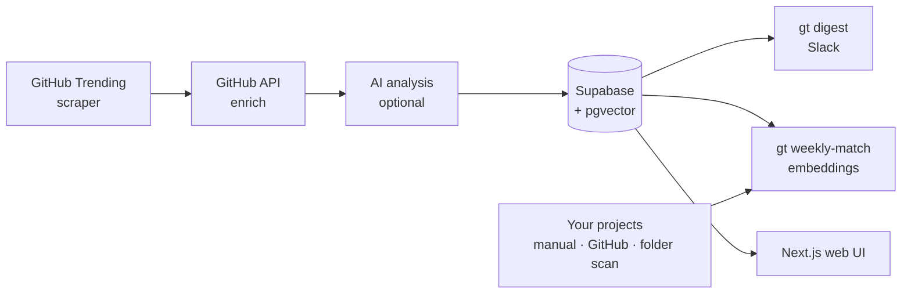

<p align="center">
  
</p>

<p align="center">
  <b>English</b> · <a href="README.ko.md"><b>한국어</b></a>
</p>

<h2 align="center">Stop scrolling GitHub Trending.<br>Get the repos that fit what you're building.</h2>

<p align="center">
  repofit collects GitHub Trending every day, scores each repo, and sends a short curated digest to Slack.<br>
  Once a week it matches stored repos against your own projects using embeddings and stack overlap.
</p>

<p align="center">
  <a href="LICENSE"></a>
  <a href="https://github.com/kks0488/repofit/stargazers"></a>
  
  
</p>

<table>
<tr>
<td width="50%" valign="top">

### Daily curation, not a raw list
Trending repos are enriched through the GitHub API and ranked by momentum (stars today), growth relative to size, and a quality score. Only the top picks are kept.

</td>
<td width="50%" valign="top">

### "Why it matters" in one line
An OpenAI-compatible model writes a short summary, use cases and risks for each repo. Run with `--no-analyze` to skip AI entirely.

</td>
</tr>
<tr>
<td width="50%" valign="top">

### Matched to your projects
Register projects by hand, sync them from your GitHub account, or scan a local folder. `gt weekly-match` filters by stack and keywords, then reranks with pgvector embeddings.

</td>
<td width="50%" valign="top">

### Slack digest and bot
`gt digest` posts the curated picks with a "Rising fast" badge. An optional Socket Mode bot answers questions from the stored repo data (RAG with langchain).

</td>
</tr>
</table>

## Install

Requires Python 3.11+.

```bash
git clone https://github.com/kks0488/repofit.git && cd repofit
python -m venv .venv && source .venv/bin/activate
pip install -e .
```

## Quick start

See today's curated Trending without any database or AI key (a `GITHUB_TOKEN` is optional and only raises the API rate limit):

```bash
export SUPABASE_URL=https://example.supabase.co SUPABASE_ANON_KEY=x SUPABASE_SERVICE_KEY=x  # placeholders; not used by this command
gt trending --no-analyze -n 10
```

The full pipeline needs Supabase (Postgres + pgvector) and an OpenAI-compatible API:

```bash
cp .env.example .env        # fill in Supabase, OpenAI and (optionally) Slack values
gt init                     # creates env files and checks the Supabase schema (schema.sql)
gt quickstart               # seeds the first curated snapshot

gt project-add --name "MyApp" --stack "python,fastapi" --tags "api,web"
gt github-sync              # or import your GitHub repos as projects

gt digest                   # send today's curated digest to Slack
gt weekly-match             # match stored repos to your projects
```

## Demo

A real run of `gt trending --no-analyze` (October 2026) and the test suite:

<p align="center"></p>

## How it works



- **Daily score:** `0.5 × trend (stars today / 250) + 0.3 × growth (stars today ÷ total × 8) + 0.2 × quality`, each capped at 1.
- **Weekly match:** stage 1 filters by tech stack, keywords and quality; stage 2 reranks by embedding similarity (`text-embedding-3-small`).
  `score = 0.5 × embedding_similarity + 0.3 × stack_overlap + 0.2 × quality_score`

## FAQ

**Do I need OpenAI?**
Not for browsing. `gt trending --no-analyze` uses only GitHub. AI summaries and project matching need an OpenAI-compatible endpoint; matching also needs `OPENAI_EMBEDDING_API_KEY`.

**Why Supabase?**
Snapshots, history, projects and embeddings are stored there. Run `schema.sql` in the Supabase SQL editor once; all tables use a `gt_` prefix.

**Can it run on a schedule?**
Yes: `gt schedule` (long-running), the systemd timer in `scripts/`, cron, or the GitHub Actions workflow. See Technical details below.

## Roadmap (planned, not built yet)

- Package the CLI for `pipx install`.
- Language and topic filters in the Slack digest.
- Hosted demo of the web UI.

---

<details>
<summary><b>Technical details</b></summary>

### CLI commands

| Command | Description |
|---------|-------------|
| `gt init` | Create env files and validate the Supabase schema |
| `gt setup` | Validate configuration and show setup hints |
| `gt quickstart` | Seed daily curation data quickly |
| `gt` / `gt trending` | View daily curated trending repos (`--lang`, `--since`, `-n`, `--no-enrich`, `--no-analyze`, `--save`) |
| `gt digest` | Send the daily curated Slack digest immediately |
| `gt inspect owner/repo` | Detailed repo analysis |
| `gt history owner/repo` | Trending history for a repo |
| `gt snapshots` | List saved trending snapshots |
| `gt projects` | List your projects |
| `gt project-add` | Register a project |
| `gt github-sync` | Sync your GitHub repos as projects (`--starred` also shows starred repos) |
| `gt scan-projects ~/projects` | Scan a local folder for projects |
| `gt weekly-match` | Thorough weekly matching for all projects (`--project <id>` for one) |
| `gt match` | Compatibility alias for `gt weekly-match` |
| `gt recommendations` | View AI recommendations |
| `gt discover` | Search GitHub for repos that fit your projects |
| `gt sync` | Daily curation sync (fetch → analyze → save); `--notify` also sends the digest |
| `gt schedule` | Run the daily sync at a fixed local time (default 19:00) |
| `gt bot` | Start the Slack auto-reply bot (Socket Mode) |

### Environment variables

```bash
# Backend (.env)
SUPABASE_URL=https://your-project.supabase.co
SUPABASE_ANON_KEY=your-anon-key
SUPABASE_SERVICE_KEY=your-service-key
OPENAI_API_KEY=your-openai-key
OPENAI_BASE_URL=https://api.openai.com/v1   # any OpenAI-compatible endpoint
OPENAI_MODEL=gpt-5.2
OPENAI_EMBEDDING_API_KEY=your-openai-embedding-key
GITHUB_TOKEN=your-github-token              # github-sync, higher rate limits

# Slack (optional)
SLACK_BOT_TOKEN=xoxb-xxx
SLACK_APP_TOKEN=xapp-xxx                    # Socket Mode, for gt bot
SLACK_CHANNEL_ID=C0123456789
SLACK_NOTIFY_THRESHOLD=0.7

# Frontend (web/.env.local)
NEXT_PUBLIC_SUPABASE_URL=your-supabase-url
NEXT_PUBLIC_SUPABASE_ANON_KEY=your-anon-key
```

If `OPENAI_BASE_URL` is not set, the code defaults to a local OpenAI-compatible proxy (`http://localhost:8317/v1`), so set it explicitly when using the OpenAI API.

### Slack setup

1. Create a Slack app at [api.slack.com/apps](https://api.slack.com/apps). Bot token scopes: `chat:write`, `channels:read`, `channels:history`. Install it and copy the `xoxb-` token, then `/invite @YourBot` in your channel.
2. For the bot: enable Socket Mode, create an app-level token with `connections:write` (`xapp-`), enable events and subscribe to `message.channels` and `app_mention`.
3. Put the tokens and channel ID in `.env`.

Bot commands typed in the channel or a thread:

| Message | Action |
|---------|--------|
| `scan` / `스캔` | Scan project folders → register → match |
| `recommend` / `추천` | Post recommendations |
| `trending` / `트렌딩` | Post the trending top 10 |
| `match` / `매칭` | Run matching and post the results |

Any other question is answered from stored repo data (langchain + pgvector retrieval).

Sample digest layout (placeholder repos):

```
📌 RepoFit Daily Trending Curation
🌐 All languages • 10 picks from 25 trending repos
────────────────────────────
*AI/ML*
  owner/repo-a ⭐ 12,421 · +684 today ⚡ Rising fast
  Why: High-velocity open-source agent framework with practical tooling.
────────────────────────────
Top 10 only: highest momentum + quality signals
```

### Daily automation

systemd user timer:

```bash
mkdir -p ~/.config/systemd/user
cp scripts/repofit-daily.{service,timer} ~/.config/systemd/user/
systemctl --user daemon-reload
systemctl --user enable --now repofit-daily.timer
```

Cron:

```bash
0 19 * * * cd /path/to/repofit && ./scripts/daily-digest.sh   # daily digest
0 9 * * 1 cd /path/to/repofit && ./scripts/weekly-match.sh    # Monday weekly match
```

GitHub Actions: `.github/workflows/daily-sync.yml` runs `gt sync --notify` daily. Add repository secrets `SUPABASE_URL`, `SUPABASE_ANON_KEY`, `SUPABASE_SERVICE_KEY`, `OPENAI_API_KEY`, `SLACK_BOT_TOKEN`, `SLACK_CHANNEL_ID` (and optionally `OPENAI_BASE_URL`, `OPENAI_MODEL`).

### Web UI

```bash
cd web
npm install
npm run dev   # http://localhost:3003
```

Pages: latest trending, your projects (add / list), and recommendations, all read from Supabase.

### Tech stack

| Component | Technology |
|-----------|------------|
| CLI | Python, Typer, Rich |
| AI | OpenAI-compatible API (analysis + embeddings), langchain |
| Database | Supabase (PostgreSQL + pgvector) |
| Frontend | Next.js 16, React 19, Tailwind CSS 4, TanStack Query |
| HTTP / scraping | httpx (async), selectolax |
| Notifications | Slack Block Kit, slack-bolt (Socket Mode) |

### Tests

```bash
pip install -e ".[dev]"
pytest -q
```

### Troubleshooting

- **Schema missing:** run `schema.sql` in the Supabase SQL editor.
- **No recommendations:** set `OPENAI_EMBEDDING_API_KEY`, then run `gt weekly-match`.
- **Slack not working:** check `SLACK_BOT_TOKEN` and `SLACK_CHANNEL_ID`.
- **No project matches:** register projects with `gt project-add` first.
- **GitHub sync fails:** check `GITHUB_TOKEN` permissions (repo scope).

</details>

## License

[MIT](LICENSE) © 2026 Kyoungsoo Kim
